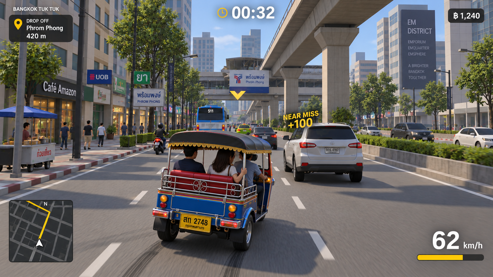

# Bangkok Tuk Tuk implementation specifications

Revision 1, 9 October 2026. These are the target specifications. A local playable build is now available; see the [project README](../../README.md).

Build a high-quality, single-player arcade driving game for desktop and mobile browsers. The player pilots a lively Bangkok tuk-tuk, chooses passengers, races delivery deadlines, earns money through skilled driving, and learns the city's shortcuts. Crazy Taxi is the gameplay reference. Bangkok Tuk Tuk is the working product name; use original characters, branding, dialogue, music, art, and implementation.

The launch requirement includes keyboard, gamepad, and phone/tablet touch controls. Mobile is part of every development milestone, rather than a port after desktop completion.

## Decisions

| Area | Decision |
| --- | --- |
| Core experience | Fast pickup and delivery loop, two clocks, distance-based fares, timed acceleration techniques, controlled drifts, rapid stops, reverse techniques, near-miss tips and combos |
| Launch world | One carefully authored, contiguous approximately 4 km² Sukhumvit district around Asok and Phrom Phong, subject to a street-data audit |
| World accuracy | Real street connectivity and landmark positions; documented width, collision and shortcut adjustments for playability |
| Visual standard | Realistic proportions and recognizable Bangkok streets, optimized modular art, strong daylight lighting and expressive passengers |
| Client | TypeScript, Vite, Three.js WebGL2, Rapier WebAssembly, native Web Audio, HTML/CSS HUD |
| World production | OpenStreetMap via Geofabrik, optional Overture building infill, Osmium and Python preprocessing, Blender, glTF Transform |
| Delivery | Static files on Cloudflare Pages; no required game server, account, map API, AI API or subscription |
| Targets | Sustained 60 FPS on the reference desktop tier; sustained 30 FPS on the reference mobile tier; full gameplay parity |
| Spending | Zero mandatory software, map-data or API fees; free hosting within provider terms and limits. Labor and access to test devices remain necessary |
| Implementation order | Prove controls and handling, then the passenger loop, then one polished Bangkok corridor, then expand the district |

The technology choices are explained and sourced in the [technical specification](technical-spec.md). Cost conditions and delivery gates are in the [production plan](production-plan.md).

## Read the specifications

1. [Game design](game-design.md): modes, controls, maneuver recognizers, timers, passengers, fares, traffic, UI, audio and fun criteria.
2. [Technical specification](technical-spec.md): engine decisions, simulation, mobile requirements, rendering, data pipeline, asset budgets, storage and verification.
3. [Production plan](production-plan.md): free resources, necessary custom work, scope, milestones, acceptance gates, cost decisions and remaining evidence to gather.

All numerical gameplay values and resource budgets are proposed starting targets, not measured results or recovered Crazy Taxi constants. Tune them through repeatable device tests and human playtests. A specification cannot guarantee the same level of fun as a finished reference game; the acceptance gates make that ambition testable.

## Visual target

This image is an AI-generated art-direction reference, not an engine capture, performance benchmark, licensed asset pack or exact reconstruction of Phrom Phong. Target its camera composition, vehicle prominence, open passenger cabin, BTS structure, street density and readability. The final mobile image will use reduced scenery detail and shadows.

The specification intentionally supersedes two details in the mockup: there must be separate shift and passenger clocks, and acceleration tricks use timing rather than a consumable boost meter. Brand logos visible in the concept are not part of the asset brief. The shipping HUD also needs a touch layout.

## What is actually free

The game can be developed and initially hosted with no mandatory cash expenditure if development hardware, test devices and the team's time are already available. The largest investment is creating and refining a good game: vehicle handling, Thai street art, animation, sound, level editing and playtesting.

Open map data supplies geography. It does not supply the complete tuk-tuk, its passengers, convincing Bangkok facades, a soundtrack or polished road meshes. Those must be created, sourced under suitable licenses or commissioned. No purchase is needed before the first handling prototype.

## Repository boundary

The user authorized replacing the prior Python traffic-camera application. The game now lives at the repository root, with runtime modules under `src/` and map-build tools under `tools/world/`. Existing Git history and this specification pack are retained. The old application is not a game dependency.

The local build supplies core gameplay and a procedural Bangkok district. Full production gates, including physical-phone thermal testing and external playtests, remain release requirements. Deployment and paid services have not been requested.
